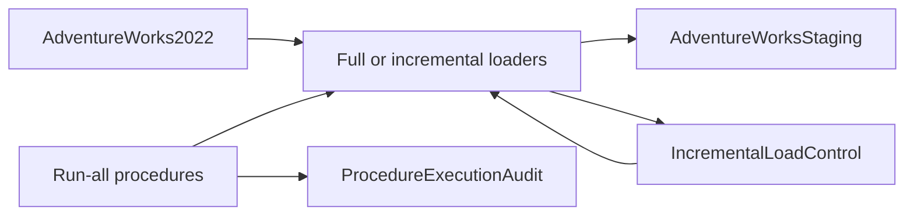

# AdventureWorks SQL Staging & ETL

SQL Server / T-SQL scripts for loading data from **AdventureWorks2022** into an
**AdventureWorksStaging** database. This project collects staging-table definitions,
a full-load procedure, timestamp-based incremental loaders, and orchestration
procedures with execution auditing.

## Project scope

- **41 staging-table definitions** across Person, Production, Purchasing, and Sales.
- A full-load procedure that truncates the selected staging tables and reloads them from the source database.
- **Five incremental procedures** using `ModifiedDate` watermarks and an `IncrementalLoadControl` table.
- **Two orchestration procedures** that run the loaders and record outcomes in `ProcedureExecutionAudit`.

This repository contains the SQL component only. Power BI reports, Talend jobs,
source database backups, and dimensional-warehouse/SCD implementations are not
included in this archive.

## Repository structure

```text
sql/
  ddl/             Person, Production, Purchasing, and Sales staging definitions
  full-load/       FullLoadAdventureWorks.sql
  incremental/     Five timestamp-based incremental loaders
  orchestration/   Two run-all procedures with execution auditing
docs/
  source-manifest.json   Archive provenance and file hashes
```

## Script index

| Script | Purpose |
| --- | --- |
| `sql/ddl/ddlperson.sql` | Defines 12 Person staging tables. |
| `sql/ddl/ddlproduction.sql` | Defines 9 Production staging tables. |
| `sql/ddl/ddlpurchasing.sql` | Defines 5 Purchasing staging tables. |
| `sql/ddl/ddlsales.sql` | Defines 15 Sales staging tables. |
| `sql/full-load/FullLoadAdventureWorks.sql` | Full staging refresh procedure. |
| `sql/incremental/IncrementalLoad_purchaseOrderDetails.sql` | Purchase order detail incremental load. |
| `sql/incremental/IncrementalLoad_purchaseOrderHeader.sql` | Purchase order header incremental load. |
| `sql/incremental/IncrementalLoad_SalesCurrencyRate.sql` | Sales currency rate incremental load. |
| `sql/incremental/IncrementalLoad_SalesOrderDetail.sql` | Sales order detail incremental load. |
| `sql/incremental/SalesOrderHeader.sql` | Sales order header incremental load. |
| `sql/orchestration/RunAllLoadProcedures.sql` | Executes the load sequence and audits results. |
| `sql/orchestration/RunAllLoadProcedures1.sql` | Alternate exported orchestration procedure. |

## Data flow



## Status and prerequisites

These are SQL Server stored-procedure exports, preserved as a project snapshot.
They use `USE`, `GO`, and `ALTER PROCEDURE`; they are not a standalone, automatic
migration bundle.

Before choosing to execute them in a development environment:

- Provide the `AdventureWorks2022` source database and an `AdventureWorksStaging` target.
- Create the procedures first or adapt their `ALTER PROCEDURE` statements for an initial deployment.
- Supply the definitions for `IncrementalLoadControl` and `ProcedureExecutionAudit`; those table definitions were not included in the archive.
- Review table keys and repeat-run behaviour: the incremental procedures insert rows selected by timestamps, while their `MERGE` statements update the watermark control table.
- Review the full-load truncation behaviour against the intended staging database.

**No SQL was executed, no database was created, and no runtime setup was performed
when preparing this repository.** Database execution and results have not been tested.

## Source preservation

Imported from the supplied `SQL ddl.rar`. File names and SQL statements are retained;
text exports were converted to UTF-8 with consistent line endings and whitespace.
The source archive hash and per-file hashes are recorded in
[`docs/source-manifest.json`](docs/source-manifest.json).
