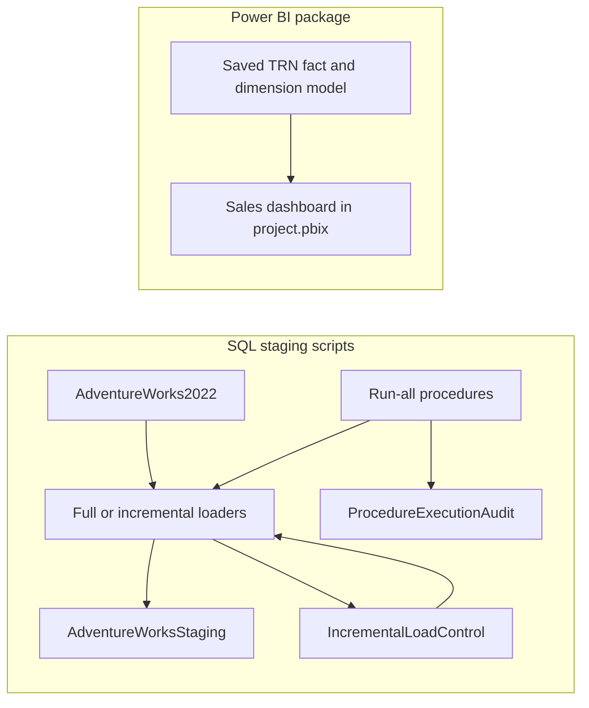

# AdventureWorks Sales Analytics — Power BI & SQL ETL

An AdventureWorks analytics project combining a **Power BI sales dashboard** with
**SQL Server / T-SQL staging and ETL scripts**. The repository includes the saved
report and model in [`project.pbix`](project.pbix), alongside SQL exports that load
`AdventureWorks2022` data into `AdventureWorksStaging`.

## What is included

| Component | Contents |
| --- | --- |
| **Power BI report** | `project.pbix`: one sales dashboard page, 15 visuals, and a saved fact/dimension model. |
| **Staging definitions** | 41 table definitions across Person, Production, Purchasing, and Sales. |
| **Full load** | A procedure that truncates selected staging tables and reloads source data. |
| **Incremental loads** | Five timestamp-based loaders using `ModifiedDate` and `IncrementalLoadControl`. |
| **Orchestration** | Two run-all procedures that record outcomes in `ProcedureExecutionAudit`. |

## Power BI sales dashboard

The report is titled **Adventure Works Sales Dashboard**. Its single saved page,
`Page 1`, uses a 1280 × 720 canvas with the following visuals:

| Area | Included analysis |
| --- | --- |
| **KPI cards** | Revenue, Customers, Orders, and Quantity. |
| **Sales by territory** | Revenue compared across customer territories. |
| **City by orders** | Order counts compared across cities. |
| **Product-category revenue** | A pie chart showing revenue by product category. |
| **Sales over time** | A revenue line chart with a year → quarter → month → day date hierarchy. |
| **Store performance** | A table of store names and revenue. |
| **Interactive filters** | Year, month, country/region code, product category, and subcategory slicers. |

The 15 visual containers comprise four KPI cards, five slicers, four charts, one
table, and one title text box.

### Measures used by the report

The KPI cards reference these measures from `TRN Sales_Fact`:

| Display label | Saved measure name |
| --- | --- |
| Revenue | `Totalrevenue` |
| Customers | `TOTALCUSTOMERS` |
| Orders | `Totalorders` |
| Quantity | `TOTAL QUANTITY` |

These are the saved measure names referenced by the visuals; DAX formulas and
computed KPI values have not been independently evaluated here.

### Saved model

The report's model diagram lists a sales fact table and eight dimension tables:

- `TRN Sales_Fact`
- `TRN Dim_Address`
- `TRN Dim_Customer`
- `TRN Dim_Date`
- `TRN Dim_Product`
- `TRN Dim_Salesperson`
- `TRN Dim_Salesterritory`
- `TRN Dim_Shipmethod`
- `TRN Dim_Specialoffer`

The Power BI package includes its saved model. The supplied SQL scripts target
staging tables; they do **not** include the database-side DDL or transformation
scripts that build these `TRN` fact/dimension objects. Talend job exports, source
database backups, and SQL implementations of SCD processing are also not included.

### Open the report

1. Download [`project.pbix`](project.pbix).
2. Open it in Microsoft Power BI Desktop.
3. Explore the KPI cards, charts, store table, and slicers.
4. If refreshing data, review the report's data-source configuration and provide access to the corresponding databases in your environment.

The PBIX is a desktop report file; GitHub does not host an interactive version of
the dashboard. Its layout and model-diagram metadata were inspected without
launching Power BI or refreshing its data.

## Repository structure

```text
project.pbix        Power BI sales dashboard and saved data model
sql/
  ddl/              Person, Production, Purchasing, and Sales staging definitions
  full-load/        FullLoadAdventureWorks.sql
  incremental/      Five timestamp-based incremental loaders
  orchestration/    Two run-all procedures with execution auditing
docs/
  source-manifest.json    Provenance and hashes for the original SQL archive
```

## SQL script index

| Script | Purpose |
| --- | --- |
| `sql/ddl/ddlperson.sql` | Defines 12 Person staging tables. |
| `sql/ddl/ddlproduction.sql` | Defines 9 Production staging tables. |
| `sql/ddl/ddlpurchasing.sql` | Defines 5 Purchasing staging tables. |
| `sql/ddl/ddlsales.sql` | Defines 15 Sales staging tables. |
| `sql/full-load/FullLoadAdventureWorks.sql` | Full staging refresh procedure. |
| `sql/incremental/IncrementalLoad_purchaseOrderDetails.sql` | Purchase order detail incremental load. |
| `sql/incremental/IncrementalLoad_purchaseOrderHeader.sql` | Purchase order header incremental load. |
| `sql/incremental/IncrementalLoad_SalesCurrencyRate.sql` | Sales currency rate incremental load. |
| `sql/incremental/IncrementalLoad_SalesOrderDetail.sql` | Sales order detail incremental load. |
| `sql/incremental/SalesOrderHeader.sql` | Sales order header incremental load. |
| `sql/orchestration/RunAllLoadProcedures.sql` | Executes the load sequence and audits results. |
| `sql/orchestration/RunAllLoadProcedures1.sql` | Alternate exported orchestration procedure. |

## Included data layers



The diagram shows the components included in the repository. It does not imply
that the provided staging scripts create or populate the report's `TRN` model.

## SQL status and prerequisites

The SQL files are SQL Server stored-procedure exports, preserved as a project
snapshot. They use `USE`, `GO`, and `ALTER PROCEDURE`; they are not a standalone,
automatic migration bundle.

Before choosing to execute them in a development environment:

- Provide the `AdventureWorks2022` source database and an `AdventureWorksStaging` target.
- Create the procedures first or adapt their `ALTER PROCEDURE` statements for an initial deployment.
- Supply definitions for `IncrementalLoadControl` and `ProcedureExecutionAudit`; those table definitions were not included in the SQL archive.
- Review table keys and repeat-run behaviour: the incremental procedures insert rows selected by timestamps, while their `MERGE` statements update the watermark control table.
- Review the full-load truncation behaviour against the intended staging database.

**No SQL was executed, no database was created, and no runtime setup was performed
when documenting this project.** Database execution, report rendering, data refresh,
and KPI results have not been tested.

## Source preservation

Imported from the supplied `SQL ddl.rar`. File names and SQL statements are retained;
text exports were converted to UTF-8 with consistent line endings and whitespace.
The source archive hash and per-file hashes are recorded in
[`docs/source-manifest.json`](docs/source-manifest.json).

`project.pbix` was added separately after the initial SQL import. The source
manifest describes only the original SQL archive; this README update leaves the
report file and SQL scripts unchanged.
